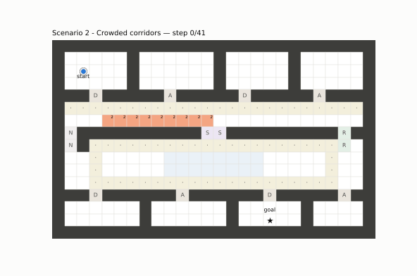
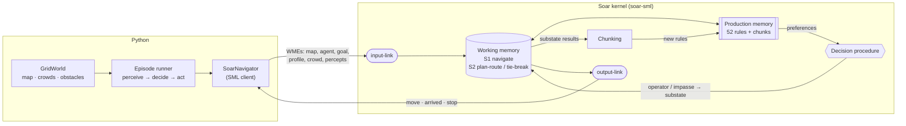
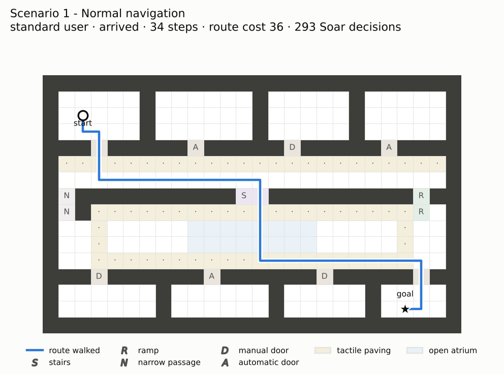
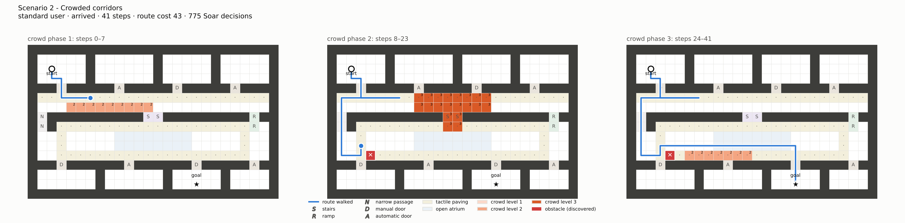
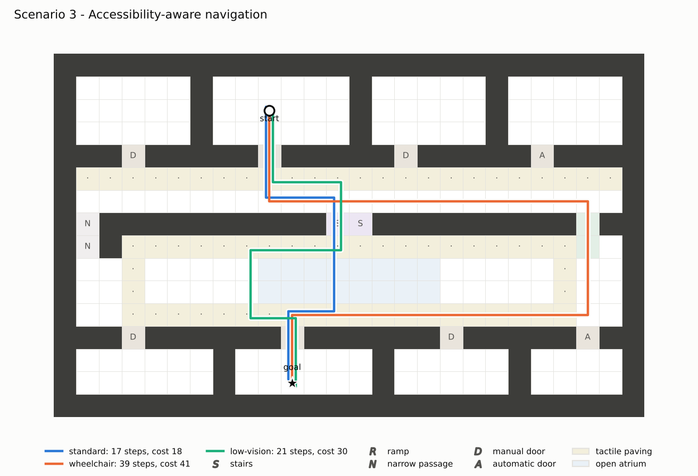
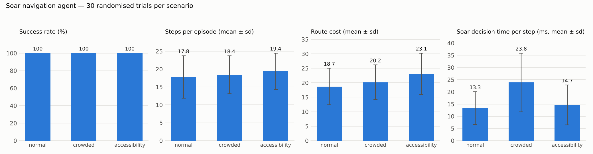
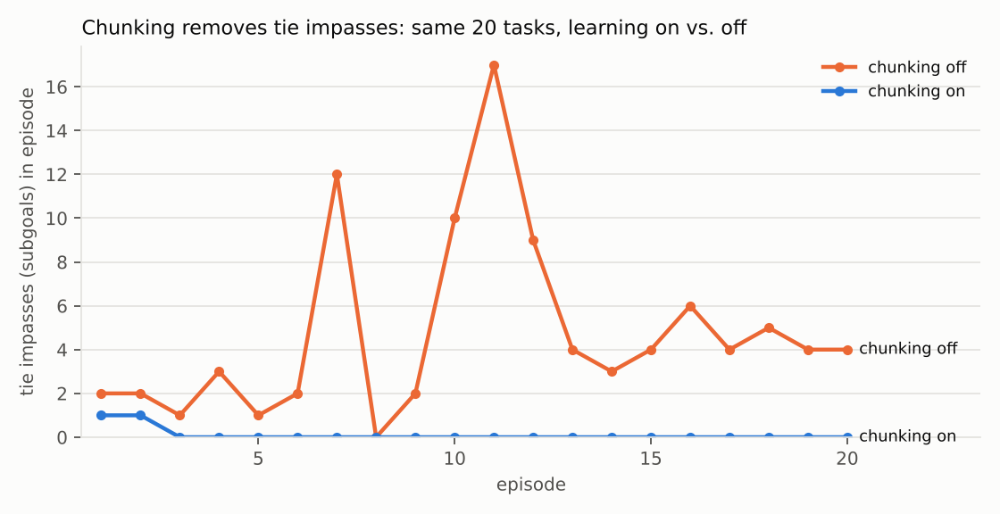

# Human-Centred Cognitive Navigation Agent using Soar

An indoor navigation agent whose reasoning runs in the **Soar cognitive
architecture** (real Soar 9.6 kernel, driven from Python through the
official **SML** interface). It plans routes on a grid floor plan, avoids
obstacles it discovers on the way, reacts to changing crowds and adapts
its route to the user's mobility profile (standard, wheelchair, low vision).



**What is in Soar, and what is in Python**

| in Soar (52 productions + learned chunks) | in Python |
|---|---|
| cost model per user profile, accessibility constraints | the grid world: map, crowds, obstacles |
| route planning (uniform-cost search in a subgoal) | SML bridge: input-link / output-link |
| move selection, obstacle memory, replanning | executing commands, measuring |
| tie-breaking in a subgoal + **chunking** | evaluation-only reference planners, plots |

Python never chooses an action. The reference Dijkstra/BFS code in
`cognav/reference.py` is used only to grade the agent.

---

## Architecture



* Component-by-component explanation: [`docs/ARCHITECTURE.md`](docs/ARCHITECTURE.md)
* Every production rule explained: [`docs/RULES.md`](docs/RULES.md)

### How the agent thinks

| Soar concept | Where it shows up |
|---|---|
| **Working memory** | map + percepts on the input-link; the agent's own cost model, obstacle memory (`^memory.blocked`), plan (`^plan.label`) and heading |
| **States** | top state `navigate`; substates `plan-route` and `tie-break` |
| **Operators** | `init-navigate, plan-route, move, record-obstacle, replan, finish, report-unreachable` · `init-plan, label, complete-plan, fail-plan` · `prefer, no-difference` |
| **Decision cycle** | input → propose → decide → apply → output; ~190 cycles for a 17-step trip |
| **Subgoaling 1** | `plan-route` has no apply rule in the top state → *operator no-change* impasse → substate runs a uniform-cost search in which the decision procedure is the priority queue |
| **Subgoaling 2** | two moves with equal route cost → *operator tie* impasse → substate compares them on human-centred criteria (less crowded, then keep heading) |
| **Chunking** | the tie-break result is compiled into a new selection rule; later ties are settled without an impasse. Deliberately disabled for `plan-route`, where chunks would be over-general ([why](docs/RULES.md#3-plan-routesoar--substate-for-the-operator-no-change-impasse-10-rules)) |

---

## Installation

Requires Python 3.9+ on Linux, macOS or Windows (x86-64 or Apple
silicon). The Soar kernel itself comes inside the `soar-sml` wheel
published by the Soar Group — no separate Soar install or build.

```bash
git clone https://github.com/khushbooshaurya5/SOAR.git
```

```bash
cd SOAR
```

```bash
python -m venv .venv && source .venv/bin/activate
```

```bash
python -m pip install -r requirements.txt
```

## Reproduce everything

```bash
python -m pytest -q
```

```bash
python scripts/run_scenarios.py
```

```bash
python scripts/evaluate.py
```

```bash
python scripts/learning_experiment.py
```

```bash
python scripts/trace_demo.py
```

(or `make all`). Each script overwrites its outputs in `results/`.
All random choices are seeded, so steps, costs, decision counts and
impasse counts reproduce exactly; only the millisecond timings depend on
the machine.

---

## The environment

`maps/campus_floor.txt` — a 26 × 16 floor with four offices, a two-lane
main corridor (one lane with tactile paving), a lower level with an open
atrium ringed by tactile paving, and three ways down: stairs (short),
a ramp (far east) and a narrow service passage (far west).

| symbol | terrain | standard | wheelchair | low vision |
|---|---|---|---|---|
| `.` | floor | 1 | 1 | 2 |
| `T` | tactile paving | 1 | 1 | 1 |
| `O` | open atrium | 1 | 1 | 5 |
| `A` | automatic door | 1 | 1 | 1 |
| `D` | manual door | 2 | 5 | 2 |
| `R` | ramp | 2 | 2 | 2 |
| `S` | stairs | 2 | **impassable** | 4 |
| `N` | narrow passage | 1 | **impassable** | 1 |
| | + per crowd level (0–3) | +1 | +2 | +2 |

These numbers are produced by the rules in `soar/cost-model.soar`
(illustrative design values, not calibrated on user data).

## The three scenarios

### 1 — Normal navigation
Office A to room H, empty building, standard user.



### 2 — Crowded corridors
The crowd picture changes twice during the walk, and a cleaning cart the
agent does not know about blocks the detour. The agent first uses the
free corridor lane, turns back when the corridor centre and stairs jam
(replan), discovers the cart when next to it (record → replan) and finally
crosses the atrium edge to avoid the last crowd.



### 3 — Accessibility-aware navigation
The same trip for three users. Standard: stairs and straight across the
atrium. Wheelchair: no stairs, so the ramp. Low vision: tactile lane in
the corridor, then around the atrium along the tactile ring.



---

## Results

Everything below was measured by the scripts in this repository
(`results/` holds the raw files). Environment of the recorded run:
Linux x86-64, Intel Xeon 2.1 GHz VM, Python 3.13.18, soar-sml 9.6.5.
**Timings will differ on your machine; the other numbers will not.**

### Showcase runs (`scripts/run_scenarios.py` → `results/scenario_results.md`)

| scenario | outcome | steps | fewest possible steps | route cost | optimal cost (static map) | crowd exposure | collisions | Soar decisions | plan subgoals | tie impasses | ms / step |
|---|---|---|---|---|---|---|---|---|---|---|---|
| normal | arrived | 34 | 34 | 36 | 36 | 0 | 0 | 293 | 1 | 2 | 8.0 |
| crowded | arrived | 41 | 27 | 43 | 30¹ | 0 | 0 | 775 | 4 | 2 | 19.0 |
| accessibility · standard | arrived | 17 | 17 | 18 | 18 | 0 | 0 | 192 | 1 | 1 | 13.9 |
| accessibility · wheelchair | arrived | 39 | 17 | 41 | 41 | 0 | 0 | 254 | 1 | 1 | 5.9 |
| accessibility · low vision | arrived | 21 | 17 | 30 | 30 | 0 | 0 | 224 | 1 | 0 | 19.1 |

¹ Cost on the empty map without crowds or the cart, shown for scale only;
it is not attainable in this scenario. The 14 extra steps are the price of
turning back when the corridor jammed.

### Randomised evaluation (`scripts/evaluate.py`, 30 trials per scenario, seed 2024)

Random start/goal pairs at least 10 steps apart. *Crowded* adds three
random crowd phases (steps 0, 8, 20) and two hidden obstacles;
*accessibility* cycles through the three profiles.



| metric | normal | crowded | accessibility |
|---|---|---|---|
| trials | 30 | 30 | 30 |
| **success rate** | 100% | 100% | 100% |
| **steps** (mean ± sd) | 17.8 ± 5.9 | 18.4 ± 5.3 | 19.4 ± 5.1 |
| **route cost** (mean ± sd) | 18.7 ± 6.3 | 20.2 ± 6.0 | 23.1 ± 7.1 |
| route cost = independent optimum | 30/30 | n/a (dynamic world) | 30/30 |
| Soar decision cycles per episode | 186.4 ± 71.4 | 308.3 ± 160.3 | 181.8 ± 58.4 |
| plan-route subgoals per episode | 1.00 | 2.63 | 1.00 |
| **decision time** per step, ms | 13.32 ± 6.73 | 23.84 ± 12.04 | 14.65 ± 8.17 |
| decision time per decision cycle, ms | 1.292 | 1.501 | 1.553 |
| collisions (total) | 0 | 0 | 0 |
| crowd exposure, agent | 0.00 | 0.63 | 0.00 |
| crowd exposure, naive baseline² | 0.00 | 3.07 | 0.00 |
| steps, naive baseline² | 17.8 | 17.6 | 18.3 |
| baseline routes entering cells the user cannot use | 0/30 | 0/30 | 4/30 |

² Fewest-steps BFS path that ignores crowds and accessibility and is told
about all obstacles in advance.

How to read this honestly:

* 100 % success is expected here, not remarkable: the map is fully known,
  and obstacles were sampled so that a route always exists. The test suite
  separately covers the case where none exists (the agent reports
  `no-accessible-route` instead of moving).
* In the static scenarios the agent's cost equals an independently
  computed Dijkstra optimum in 60/60 trials. That is a correctness check of
  the Soar rules, not a claim of superiority.
* In the crowded scenario the agent walks 0.8 more steps on average than
  the naive baseline and meets about a fifth of the crowding (0.63 vs 3.07).
* "Decision time per step" is wall-clock time inside `RunSelfTilOutput`,
  so steps that replan are expensive and ordinary steps are cheap.

### Does chunking help? (`scripts/learning_experiment.py`, 20 episodes, seed 7)

One agent, 20 consecutive tasks, production memory kept between tasks.



| | chunking on | chunking off |
|---|---|---|
| tie impasses over 20 episodes | 2 | 95 |
| chunks learned | 2 | 0 |
| total decision cycles | 3417 | 3621 |
| total route cost | 372 | 372 |
| successes | 20/20 | 20/20 |

Two chunks (one per criterion that came up: keep-heading and
no-difference) removed every later tie impasse; behaviour quality is
unchanged. The saving in decision cycles is only 5.6 % because planning,
which is not chunked, dominates. The less-crowded criterion did not occur
in this sequence; `tests/test_soar_agent.py::test_tie_break_prefers_less_crowded_cell`
exercises it and its chunk. The learned rules are in
[`results/learned_chunks.soar`](results/learned_chunks.soar); a kernel
trace showing both impasses is in
[`results/sample_trace.txt`](results/sample_trace.txt).

---

## Repository layout

```
soar/                 the agent's knowledge (Soar productions)
  load.soar             loader + chunking mode
  cost-model.soar       profile-specific costs, accessibility, obstacle beliefs
  navigate.soar         top-level operators
  plan-route.soar       planning substate (operator no-change)
  tie-break.soar        tie substate (chunked)
cognav/               Python package
  grid.py               environment
  soar_agent.py         SML bridge (the only file that talks to Soar)
  simulation.py         episode loop + metrics
  scenarios.py          scenario loader
  cost_model.py         evaluation-only mirror of the cost table
  reference.py          evaluation-only Dijkstra / BFS
  viz.py                figures
maps/  scenarios/     floor plan and the three scenario definitions
scripts/              run_scenarios · evaluate · learning_experiment · trace_demo
tests/                20 tests (15 run the real Soar kernel)
docs/                 ARCHITECTURE.md · RULES.md
results/              generated figures, tables, trace, learned chunks
```

## Interview talking points

1. **Why Soar and not A\* in Python?** The point is the architecture:
   knowledge is declarative rules, control emerges from preferences and
   impasses, and the same agent explains itself (`^impassable stairs`,
   `^criterion keep-heading`) and learns. Adding a user profile means
   adding rules, not touching control flow.
2. **Where exactly is the subgoaling?** Two different impasse types, each
   used for what it is good at: no-change for task decomposition, tie for
   deliberate choice.
3. **When is chunking wrong?** In the planner: selection there depends on
   better-preferences that are not backtraced, so chunks would be
   over-general. Knowing where *not* to learn is part of the design.
4. **A real performance bug.** A poorly indexed condition made the Rete
   join all cell models with all labels (43 ms/decision); re-linking the
   model from the cell fixed it (~1 ms/decision) without changing any rule's
   meaning.
5. **How do you know it is correct?** Route cost is compared with an
   independent planner in the tests and in every static evaluation trial.

## Limitations

Single floor, 4-connected grid, scripted crowd phases, fully known floor
plan, full replan on every crowd change, illustrative cost weights. See
[`docs/ARCHITECTURE.md`](docs/ARCHITECTURE.md#7-limitations).

## License

MIT — see [`LICENSE`](LICENSE).
