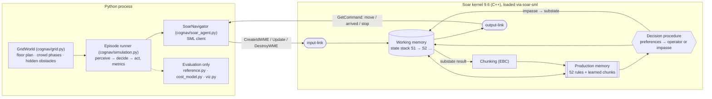
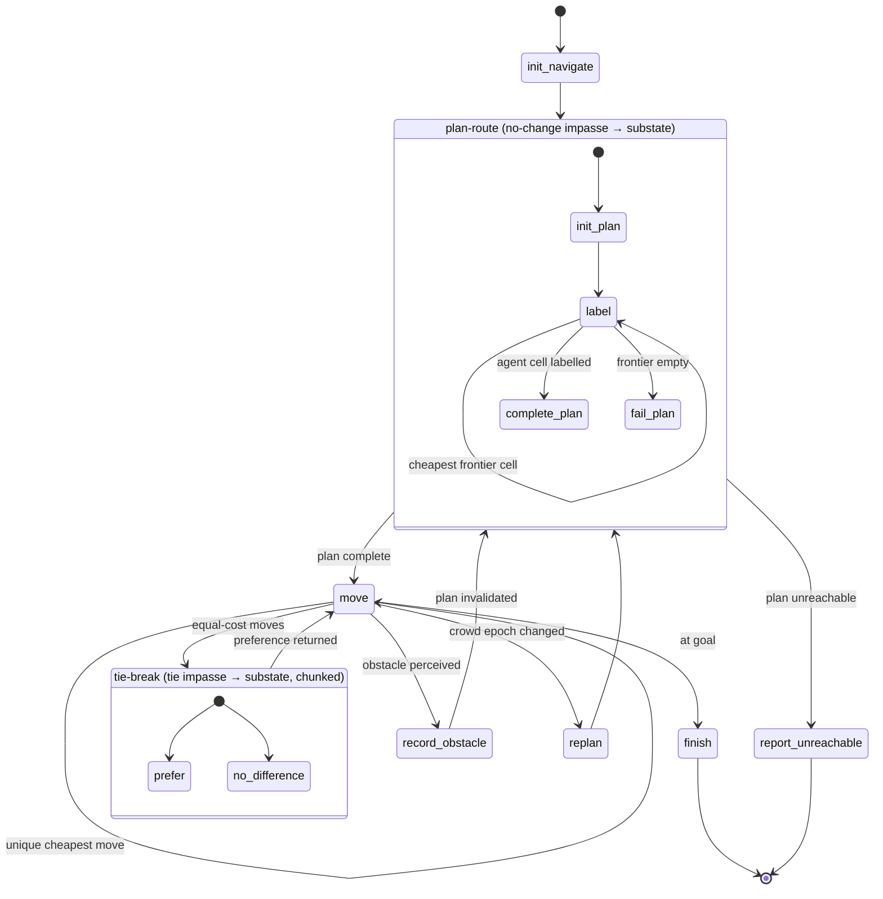

# Architecture — every component explained

## 1. Big picture



**Division of labour.** Python is the *world* and the *instrument*: it
holds the map, moves the crowds, executes motor commands and measures.
It contains no route logic on the agent's side. Soar is the *mind*:
costs, planning, selection, obstacle beliefs, replanning and learning
are all productions. The plain-Python planners in `cognav/reference.py`
exist only to grade the agent and are never connected to it.

## 2. Soar components and how this project uses each

| Soar component | Use in this project |
|---|---|
| **Working memory (WM)** | A graph of `(identifier ^attribute value)` elements. Holds perception (`io.input-link`), the agent's cost model, its obstacle memory, its plan and its heading. ~5 000 WMEs on this map. |
| **Input-link** | Written by Python through SML: `^map` (cells with `^x ^y ^terrain ^crowd` and `^neighbor` links), `^agent.cell`, `^goal.cell`, `^user.profile`, `^crowd-epoch`, `^percept.obstacle`. |
| **Output-link** | Written by rules: `^move.dir`, `^arrived`, `^stop.reason`. Python reads commands with `GetCommand` and acknowledges with `AddStatusComplete`. |
| **Production memory** | 52 rules in `soar/` ([RULES.md](RULES.md)) + chunks. Matched by the Rete network. |
| **States** | `S1` top state (`^name navigate`). Substates are created by the architecture on an impasse: `plan-route` (operator no-change) and `tie-break` (operator tie). |
| **Operators** | Top: `init-navigate, finish, report-unreachable, record-obstacle, replan, plan-route, move`. `plan-route` space: `init-plan, label, complete-plan, fail-plan`. `tie-break` space: `prefer, no-difference`. |
| **Preferences** | acceptable `+`, better `>` (cost, priority, cheapest label), best `>` (complete-plan), worst `<` (fail-plan), unary/binary indifferent `=`. No selection is done with if/else in Python. |
| **Decision cycle** | input → propose (elaboration to quiescence) → decide → apply → output. One operator per cycle. |
| **Impasses / subgoaling** | Operator **no-change** on `plan-route` → hierarchical decomposition. Operator **tie** between equal-cost moves → deliberate comparison. |
| **Chunking (EBC)** | On for `tie-break` (returns preferences → learned selection rules). Off for `plan-route` via `dont-learn`, because chunks there would be over-general. |
| **Truth maintenance (i- vs o-support)** | Costs are i-supported elaborations → auto-update when crowds change. Obstacle memory, heading and plan are o-supported → persist until an operator removes them. |
| **Not used** | SMem, EpMem, RL, SVS. (Honest scope: they were not needed for this task.) |

## 3. Working-memory layout

```
S1 ^name navigate
   ^profile standard            ^crowd-weight 1          (elaborated)
   ^heading east                                         (o-supported)
   ^memory M1 ── ^blocked <cell> …                       (obstacle beliefs)
   ^plan P1 ─┬─ ^status building|complete|unreachable
             ├─ ^epoch 2                                 (crowd picture it is valid for)
             └─ ^label L* ── ^cell <cell> ^dist 17 ^via <cell>
   ^io ─┬─ ^input-link I2 ─┬─ ^map ── ^cell C* ─┬─ ^x ^y ^terrain ^crowd      (Python)
        │                  │                    ├─ ^neighbor N* ── ^dir ^cell (Python)
        │                  │                    └─ ^model K* ── ^base-cost ^crowd-cost
        │                  │                                    [^access-penalty] [^impassable]
        │                  │                                    [^enter-cost]   (rules)
        │                  ├─ ^agent.cell   ^goal.cell   ^user.profile
        │                  └─ ^crowd-epoch  ^percept.obstacle
        └─ ^output-link I3 ── ^move.dir | ^arrived | ^stop.reason
   ^operator O* ── ^name move ^dir north ^to <cell> ^value 18 ^priority 1
```

## 4. One trip through the decision cycles

Real kernel trace (`results/sample_trace.txt`, abridged):

```
 1:    O: O1 (init-navigate)
 2:    O: O2 (plan-route)                 abstract operator selected …
 3:    ==>S: S2 (operator no-change)      … nothing applies it → SUBGOAL
 4:       O: O3 (init-plan)
 5:       O: O6 (label)                   uniform-cost search, one cell per decision
 …
88:       O: O165 (complete-plan)         result → impasse resolved, S2 removed
89:    O: O166 (move)
91:    O: O171 (move)
92:    ==>S: S3 (operator tie)            two moves with equal cost → SUBGOAL
93:       O: O176 (prefer)                keep-heading criterion → result → CHUNK learned
94:    O: O174 (move)
 …
99:    O: O196 (finish)
```



## 5. Python modules

| module | role | talks to Soar? |
|---|---|---|
| `cognav/grid.py` | ASCII floor plan → cells/terrain; crowd phases with an epoch counter; obstacles visible only when adjacent | no |
| `cognav/soar_agent.py` | SML bridge: kernel + agent creation, `LoadProductions`, input-link mirroring, `RunSelfTilOutput`, output commands, trace capture, firing counts | **yes (only place)** |
| `cognav/simulation.py` | perceive–decide–act loop, executes commands, collects metrics | via the bridge |
| `cognav/scenarios.py` | scenario JSON → dataclass | no |
| `cognav/cost_model.py`, `cognav/reference.py` | evaluation-only mirror of the cost table, Dijkstra optimum, naive BFS baseline | no — never shown to the agent |
| `cognav/viz.py` | route maps, GIF, metric and learning charts | no |

## 6. Design decisions worth defending

1. **Planning as a subgoal, not as a Python call.** The agent's route is
   derived by `label` operators selected through preferences; the tests
   check it against an independent Dijkstra (equal cost in every trial).
2. **Hard constraints vs. soft preferences.** "Wheelchair cannot use
   stairs" removes the cell (`^impassable`); "low vision dislikes the
   atrium" is a cost. Mixing the two up either strands users or sends
   them somewhere unsafe.
3. **Perception vs. belief.** Crowds come from a building-wide feed
   (global, on the input-link). Obstacles are seen only when adjacent and
   must be *remembered* (o-supported `^memory.blocked`).
4. **Chunk only where it is sound.** See RULES.md §3.
5. **Rete lesson.** The first version stored cell models on the state
   (`S1 ^cell-model K`, `K ^cell C`). The label proposal then joined all
   models against all labels: ~43 ms per decision. Linking the model
   *from* the cell (`C ^model K`) made the same logic run at ~1 ms per
   decision. Rule *semantics* were identical; only the match cost changed.

## 7. Limitations

* One floor, 4-connected grid, discrete time; crowd levels are scripted
  phases, not simulated pedestrians.
* The whole floor plan is given; only obstacles are discovered.
* Every crowd change triggers a full replan (simple, not minimal).
* Cost weights are illustrative design choices, not calibrated on user
  studies.
* Chunking removes tie impasses but planning dominates the decision
  count, so the overall speed-up from learning is small (see README).
